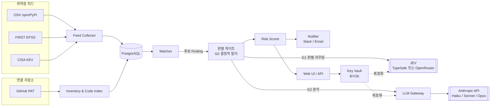
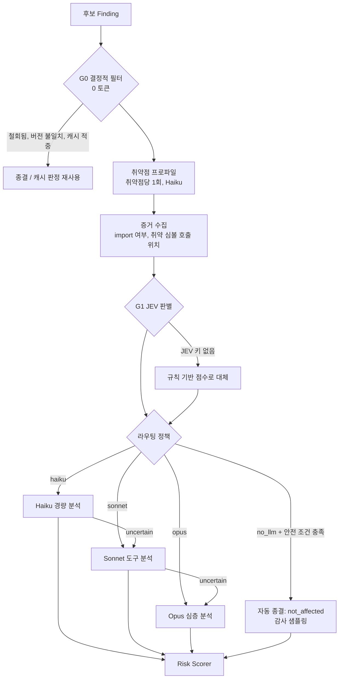

# AutoCVE 아키텍처

MVP 범위는 [01-mvp-scope.md](01-mvp-scope.md)를 참고한다.

## 1. 설계 원칙

1. **비싼 판단은 마지막에.** 0토큰 규칙 → JEV 판별(초저가) → Haiku → Sonnet/Opus 순으로, 앞 단계에서 끝낼 수 있으면 끝낸다.
2. **판별과 설명을 분리한다.** "영향이 있는가", "어느 모델이 필요한가"는 JEV가 확률로 답한다. 사람이 읽을 근거 문장은 Claude가 쓴다.
3. **위험한 쪽으로 틀린다.** 자동 종결은 확률이 높고 심각도가 낮을 때만 한다. KEV 등재나 Critical 후보는 반드시 Claude 확인을 거친다.
4. **같은 질문은 두 번 묻지 않는다.** 판정은 `(취약점, 패키지@버전, 관련 코드 지문, 프롬프트 버전, 모델)` 단위로 캐싱한다.
5. **키는 사용자 것이다.** Anthropic 키와 JEV 키(TypeSafe 또는 OpenRouter)는 암호화해서 저장하고, 로그·에러·트레이스에 절대 남기지 않는다. 예산 상한을 넘으면 호출을 멈춘다.

## 2. 전체 구성



| 컴포넌트 | 역할 | 실행 방식 |
|----------|------|-----------|
| Feed Collector | OSV 증분 수집, EPSS/KEV 갱신 | 스케줄러 (OSV 1시간, EPSS/KEV 1일) |
| Inventory & Code Index | 저장소 clone, lockfile 파싱, import 인덱스와 파일 해시 | 스케줄러(일 1회) + 수동 트리거 |
| Matcher | 버전 범위 매칭 → 후보 Finding 생성 | 이벤트 기반 (새 취약점, 새 인벤토리) |
| 판별 게이트 | G0 필터 → G1 JEV → G2 Claude 분석 | 작업 큐 워커 |
| LLM Gateway | 모델 호출, 캐싱, 배치, 사용량 기록, 예산 집행 | 워커 내부 모듈 |
| Risk Scorer | 최종 위험도 계산 | 워커 내부 모듈 |
| Notifier | 즉시/일일 요약 알림 | 작업 큐 워커 |
| Web UI / API | 프로젝트, Finding, 키 설정, 사용량 화면 | FastAPI |

## 3. 데이터 수집과 매칭

### 3.1 피드

| 소스 | 받는 방법 | 용도 |
|------|-----------|------|
| OSV | 생태계별 `all.zip`으로 초기 적재. 이후 `modified_id.csv`로 변경분만 개별 JSON 수집 | 영향 버전 범위, 요약/상세, 참조 링크(수정 커밋), 별칭(CVE/GHSA) |
| EPSS | FIRST EPSS API 또는 일일 CSV | 30일 내 악용 확률 |
| CISA KEV | 공식 JSON 피드 | 실제 악용 여부 |

### 3.2 인벤토리

- lockfile에서 `(ecosystem, name, version, direct|transitive, prod|dev, manifest_path)`를 추출한다. 패키지 식별자는 purl을 쓴다.
- 코드 인덱스: prod 코드 파일마다 `import된 패키지 목록`, `파일 해시`를 저장한다. 테스트와 스크립트 디렉터리는 따로 표시한다.
- 저장소 전체 해시가 같으면 재인덱싱을 생략한다.

### 3.3 매칭

- 버전 비교는 생태계 규칙을 따른다. npm은 SemVer, PyPI는 PEP 440(`packaging.version`)이다.
- OSV `ranges.events`의 `introduced`/`fixed`/`last_affected`를 그대로 해석한다.
- 양방향으로 매칭한다.
  - 취약점이 새로 들어오거나 수정되면 `(ecosystem, name)` 인덱스로 영향받는 컴포넌트를 찾는다.
  - 인벤토리가 바뀌면 바뀐 컴포넌트만 로컬 취약점 DB와 대조한다.
- 결과는 `Finding(status=new)`로 저장한다.
- 같은 취약점이 여러 DB에 실려 있으면(GHSA, PYSEC 등 `aliases`로 연결) 하나만 남긴다. 우선순위는 GHSA > CVE > PYSEC이다.
- 컴포넌트는 lockfile 안의 설치 위치(`locator`) 단위로 유지한다. 버전이 바뀌면 같은 행을 갱신하고 기존 Finding을 다시 평가한다. 더 이상 영향 범위가 아니면 `resolved`로 바꾼다.
- OSV npm 피드에는 악성 패키지 항목(`MAL-…`)도 들어 있다. 이것도 Finding으로 만든다.

## 4. 판별 게이트 (JEV)

토큰 최적화의 핵심이다. 후보 하나가 거치는 경로는 아래와 같다.



### 4.1 G0: 결정적 필터 (0 토큰)

- 철회된 취약점이거나 버전 범위 밖이면 종결한다.
- 판정 캐시에 적중하면 이전 판정을 재사용한다. 캐시 키는 `(advisory_id, advisory_modified, purl@version, 관련 파일 해시 집합, prompt_version, model)`이다.
- dev 의존성만 해당되면 설정에 따라 `Low`로 기록하고 분석을 생략한다. 기본값은 생략이다.

### 4.2 취약점 프로파일 (취약점당 1회)

JEV는 텍스트를 생성하지 못하므로, 매칭된 취약점마다 **Haiku로 한 번만** 구조화된 프로파일을 뽑아 캐싱한다. 이 프로파일은 같은 취약점에 걸린 모든 저장소와 컴포넌트가 재사용한다.

```json
{
  "vulnerable_symbols": ["lodash.template", "_.template"],
  "trigger_conditions": "사용자 입력이 template 옵션 sourceURL로 전달될 때",
  "preconditions": ["옵션 객체가 외부 입력에서 생성됨"],
  "attack_vector": "network",
  "fixed_versions": ["4.17.21"]
}
```

입력은 OSV `summary`/`details`, 그리고 참조에 수정 커밋이 있으면 그 diff다. diff는 테스트를 뺀 변경 hunk만 넣는다. 그래도 길면 잘라내지 말고 `profile_incomplete`로 표시한다.

### 4.3 G1: JEV 판별과 라우팅

후보마다 JEV를 **한 번** 호출해 두 가지 질문을 동시에 묻는다.

| 질문 | 타입 | 선택지 | 쓰임 |
|------|------|--------|------|
| `exposure` | choice | `not_affected`, `possibly_affected`, `likely_affected` | 위험 여부 확률 |
| `analysis_route` | choice | `no_llm`, `haiku`, `sonnet`, `opus` | 분석 모델 선택 |

각 선택지에는 판단 기준이 될 설명을 붙인다. 예시는 다음과 같다.

- `no_llm`: 패키지가 prod 코드에서 import되지 않음. 근거가 명확해 설명이 필요 없음.
- `haiku`: 호출 위치가 적고(≤3) 조건이 단순함. 스니펫만으로 판단 가능함.
- `sonnet`: 여러 파일에 걸친 데이터 흐름을 따라가야 함.
- `opus`: 설정·인증 경로 등 복합 조건이 있고, 심각도가 높아 오판 비용이 큼.

**state(입력)는 짧게 만든다.** 단가는 입력에만 붙으므로 목표는 4K 토큰 이하다. 컨텍스트 한도는 자료마다 다르다(서드파티 가이드 32K, OpenRouter 공식 문서 262,144). 구현은 보수적으로 32K를 상한으로 잡는다.

```
[취약점] id, 요약 2~3문장, 프로파일(취약 심볼, 트리거 조건)
[신호]   CVSS, EPSS, KEV 여부, 공격 벡터
[컴포넌트] purl@version, direct|transitive, prod|dev
[증거]   import 파일 수, 취약 심볼 호출 위치 수, 대표 스니펫 최대 3개(각 ±10줄)
```

호출 위치가 많으면 스니펫을 묶음으로 나눠 여러 번 호출한다. `exposure`는 묶음 중 최댓값을, `analysis_route`는 가장 높은 등급을 채택한다.

### 4.4 라우팅 정책 (확률 → 행동)

JEV 출력을 그대로 따르지 않고, 확률 임계값과 안전 규칙으로 최종 행동을 정한다. 임계값은 설정값이며, M5에서 정답 셋으로 보정한다.

| 조건 | 행동 |
|------|------|
| `P(not_affected) ≥ 0.90` 그리고 `route=no_llm` 그리고 KEV 아님 그리고 CVSS < 9.0 | **자동 종결.** 근거는 템플릿 문장으로 작성 ("prod 코드에서 import 없음" 등) |
| 그 외 | `analysis_route`의 모델로 분석 |
| `confidence < 0.6` | 라우팅 결과보다 한 단계 위 모델 사용 |
| KEV 등재 또는 CVSS ≥ 9.0 | 최소 Sonnet 사용, 자동 종결 금지 |
| 월 예산 80% 도달 | Opus 라우팅을 Sonnet으로 낮추고 사용자에게 알림 |
| 월 예산 100% 도달 | Claude 호출 중단. Finding은 `unanalyzed` 상태로 JEV 확률과 사전 점수만 표시 |

**감사 샘플링**: 자동 종결 건의 5%는 Haiku로 재확인해 JEV 오판율을 계속 측정한다. 오판율이 목표(5%)를 넘으면 자동 종결 임계값을 자동으로 올린다.

**JEV 키가 없을 때**: 같은 정책 테이블에 규칙 기반 점수를 넣는다. import가 없으면 `no_llm`, 호출 위치가 3개 이하면 `haiku`, 그 외는 `sonnet`, KEV/Critical이면 `opus`로 보낸다.

### 4.5 G2: Claude 분석

| 경로 | 방식 | 출력 |
|------|------|------|
| Haiku | 단일 호출. 프로파일과 스니펫을 넣고 구조화 출력(`output_config.format`)을 받음 | `verdict`, `confidence`, `rationale`(3문장 이내), `evidence[]` |
| Sonnet / Opus | 도구 루프. `read_file`, `search_code`, `list_callers`를 쓰고, 호출 횟수와 `task_budget`에 상한을 둠 | 위와 같은 스키마 + 데이터 흐름 경로 |

- `verdict`가 `uncertain`이면 한 단계 위 모델로 **한 번만** 올린다. Opus에서도 불확실하면 `uncertain`으로 확정하고 사람이 검토하도록 표시한다.
- Opus와 Sonnet 호출에는 서버 측 refusal fallback(`fallbacks: "default"`)을 켠다. 보안 주제라 `cyber` 분류기에 걸릴 수 있다. 응답의 `stop_reason == "refusal"`을 항상 먼저 확인하고, 거부된 건은 `analysis_refused`로 기록한다. Haiku는 서버 측 fallback이 없으므로 거부 시 Sonnet으로 재시도한다.

### 4.6 검증이 필요한 JEV 사항

아래 내용은 서드파티 가이드와 검색 결과로만 확인한 것이다. 구현 전에 공식 문서(docs.typesafe.ai, openrouter.ai/docs)로 검증한다.

| 항목 | TypeSafe 직접 | OpenRouter 경유 |
|------|---------------|-----------------|
| 엔드포인트 | `POST https://api.typesafe.ai/v1/systemone` | `POST https://openrouter.ai/api/v1/systemone` (TypeSafe 호환). 별도로 alpha 단계인 `POST /api/alpha/decisions`도 있음 |
| 인증 | TypeSafe 키, Bearer | OpenRouter 키, Bearer |
| 모델 ID | `jev-latest`, 응답에는 `jev-1.13.0` 등으로 표시 | `typesafe/jev-1.14`, `typesafe/jev-1.13`, 별칭 `~typesafe/jev-latest` |
| 과금 | TypeSafe 계정. 입력 $0.042/MTok, 출력 무과금 | OpenRouter 계정 크레딧 |
| 모델 조회 | — | 기본 모델 목록에는 없음. `GET /api/v1/models?output_modalities=decisions`로 조회 |

공통 사항은 다음과 같다.

- 요청 본문: `model`, `state`, `questions{이름: {type, instructions, options/criteria}}`
- 응답: 질문별 `choice`, `confidence`, `probabilities`
- `/api/v1/chat/completions`로 보내면 안 된다. JEV는 판별 전용 엔드포인트를 쓴다.
- 운영에서는 `latest` 별칭 대신 **버전을 고정**한다. 임계값 보정이 모델 버전에 묶이기 때문이다. 두 제공자의 버전 표기가 다르므로 `model_version`은 응답에서 읽어 저장한다.
- 버전에 따라 지원하는 질문 타입이 다르다 (예: Box 타입은 1.14부터). MVP는 `choice`만 쓰므로 1.13 이상이면 된다.

### 4.7 JEV 제공자 선택

워크스페이스 설정에서 JEV 제공자를 고른다. 판별 로직과 라우팅 정책은 제공자와 무관하게 같다.

| 제공자 | 고를 이유 |
|--------|-----------|
| TypeSafe 직접 | 단가가 명확하고, 데이터가 TypeSafe 한 곳으로만 간다 |
| OpenRouter | 이미 OpenRouter 계정과 크레딧이 있으면 키를 새로 만들 필요가 없다 |
| 없음 | 규칙 기반 판별(`RuleTriage`)로 동작 |

두 제공자 모두 TypeSafe 호환 `systemone` 형식을 쓰므로, 어댑터는 **base URL, 키, 모델 ID만 다른 같은 클라이언트**로 만든다. 한쪽에서 오류가 나도 다른 쪽으로 자동 전환하지는 않는다. 사용자가 고른 제공자로만 비용이 나가야 하기 때문이다. 대신 실패한 후보는 `RuleTriage`로 판별하고 `triage_degraded`로 표시한다.

```python
class TriageModel(Protocol):
    def judge(self, state: TriageState) -> TriageResult: ...
    # TriageResult: exposure_probs, route_probs, confidence, provider, model_version

class SystemOneTriage(TriageModel):          # JEV systemone 형식 공통 구현
    def __init__(self, base_url: str, api_key: str, model: str): ...

def jev_typesafe(key: str) -> SystemOneTriage:
    return SystemOneTriage("https://api.typesafe.ai/v1", key, model=JEV_TYPESAFE_MODEL)

def jev_openrouter(key: str) -> SystemOneTriage:
    return SystemOneTriage("https://openrouter.ai/api/v1", key, model="typesafe/jev-1.14")

class RuleTriage(TriageModel): ...           # JEV 키가 없거나 호출 실패 시
```

**OpenRouter의 `typesafe/jev-router`는 쓰지 않는다.** 이 모델은 JEV가 요청마다 응답할 LLM과 effort를 골라 OpenRouter 안에서 바로 실행한다. 다만 이 서비스에는 맞지 않는다.

- 분석은 사용자의 Anthropic 키로 Claude를 호출해야 한다.
- §4.4의 안전 규칙(KEV/Critical은 최소 Sonnet, 예산 상한)을 적용할 수 없다.
- 프롬프트 캐싱과 Batch API를 직접 제어할 수 없다.

그래서 JEV는 **라우팅 결정만** 받고, 실행은 LLM Gateway가 한다.

## 5. LLM Gateway와 토큰 최적화

### 5.1 BYOK 키 관리

| 항목 | 방식 |
|------|------|
| 입력 | 웹 UI 설정 화면. Anthropic 키는 필수. JEV 키는 선택이며, 제공자(TypeSafe 또는 OpenRouter)와 함께 입력 |
| 검증 | Anthropic은 `GET /v1/models`로 확인 (토큰 소모 없음). JEV는 고른 제공자에 최소 판별 요청 1회로 확인 |
| 저장 | AES-256-GCM으로 암호화. 마스터 키는 환경변수로 받고, Phase 2에서 KMS로 전환. 화면에는 끝 4자리만 표시 |
| 사용 | 워커가 호출 직전에만 복호화하고 메모리에만 둔다 |
| 유출 방지 | 로깅 필터로 `sk-ant-`, `sk-or-` 등 키 패턴과 저장된 키 문자열을 마스킹하고, 예외 메시지와 트레이스에서 `Authorization`/`x-api-key` 헤더를 제거 |
| 교체/삭제 | 키를 교체하면 진행 중인 작업은 다음 호출부터 새 키 사용. 삭제 시 암호문 즉시 폐기 |

워크스페이스별 모델 설정의 기본값은 다음과 같다.

| 용도 | 기본 모델 | 바꿀 수 있는 값 |
|------|-----------|-----------------|
| 취약점 프로파일, 경량 분석 | `claude-haiku-5-5` | — |
| 중간 분석 | `claude-sonnet-5-5` | — |
| 심층 분석 | `claude-opus-5-5` | `claude-sonnet-5-5`로 낮추기 |

### 5.2 토큰 절감 기법

| 기법 | 적용 위치 | 효과 |
|------|-----------|------|
| JEV 우선 판별 | 모든 후보 | Claude 호출 자체를 줄임 (가장 큼) |
| 판정 캐시 | G0 | 코드와 취약점이 안 바뀌면 재분석 없음 |
| 취약점 프로파일 공유 | 프로파일 | 취약점당 1회 생성 후 모든 저장소가 재사용 |
| 프롬프트 캐싱 | Claude 호출 전부 | 고정 system 프롬프트와 출력 스키마 → 취약점 프로파일 순서로 앞에 두고 `cache_control` 지정. 저장소별 스니펫은 뒤에 둔다 |
| Batch API (50% 할인) | 긴급하지 않은 분석 | 새 저장소 초기 스캔, 코드 변경에 따른 재분석, Low 예상 후보. KEV/Critical은 실시간 |
| 구조화 출력 | Haiku/Sonnet/Opus | 짧은 JSON만 받음. 경량 분석은 `max_tokens`를 작게 |
| effort 조절 | 모델별 | Haiku 경량 분석은 `low`, 심층 분석은 `medium`부터 시작해 측정 후 조정 |
| 컨텍스트 최소화 | 증거 수집 | 파일 전체 대신 호출 위치 ±N줄만. 같은 스니펫은 중복 제거 |

**프롬프트 캐싱 주의점**

- 캐시는 모델별로 따로 잡힌다. 같은 모델 호출끼리 묶어서 보내야 적중률이 오른다. 그래서 큐를 `모델 × 취약점` 단위로 그룹핑한다.
- 최신 모델의 최소 캐시 길이는 512토큰이다. 이보다 짧은 프리픽스는 조용히 캐싱되지 않는다.
- 적중 여부는 `usage.cache_read_input_tokens`로 확인한다.

**비교 실험 (M5)**: JEV 라우팅 캐스케이드와 "Opus 단일 모델 + 낮은 effort"를 같은 정답 셋에서 비교한다. 캐스케이드는 모델이 나뉘어 캐시 재사용을 잃는다. 단일 모델이 비용 대비 더 나을 수도 있으므로 반드시 측정한다.

### 5.3 사용량 기록

호출마다 아래 값을 `llm_usage` 테이블에 기록한다.

- 공통: `provider`(anthropic/typesafe/openrouter), `model`, `stage`(profile/jev/haiku/sonnet/opus), `finding_id`, `batch` 여부
- Anthropic: `input_tokens`, `output_tokens`, `cache_creation_input_tokens`, `cache_read_input_tokens`
- JEV: 입력 토큰. OpenRouter는 응답에 실제 과금액이 오면 그 값을 우선 기록한다.
- 그 외 비용은 설정 파일의 `(provider, model)`별 단가표로 계산한다. 단가가 바뀌면 단가표만 갱신한다.

대시보드에는 다음을 보여준다.

- 일별·단계별 비용
- Claude 호출 없이 종결된 비율, 모델별 라우팅 분포
- 캐시 적중률, 예산 대비 사용률

## 6. 위험도 산정

```
risk = 100 × severity × exploit × reachability × exposure
```

| 요소 | 값 |
|------|-----|
| severity | CVSS base / 10 (없으면 OSV 심각도 등급을 0.9/0.7/0.5/0.3으로 환산) |
| exploit | KEV면 1.0. 아니면 `0.7 + 0.3 × EPSS` (악용 이력이 없어도 도달 가능한 High 취약점이 Medium 아래로 떨어지지 않도록) |
| reachability | `affected` 1.0, `uncertain` 0.6, `not_affected` 0.05 |
| exposure | prod 인터넷 노출 1.0, prod 내부 0.7, dev 전용 0.2 (프로젝트 설정) |

| 등급 | 점수 | 알림 |
|------|------|------|
| Critical | ≥ 70 | 즉시 |
| High | 40–69 | 즉시 |
| Medium | 20–39 | 일일 요약 |
| Low | 5–19 | 일일 요약 |
| Info | < 5 | 대시보드만 |

리포트에는 점수와 함께 각 요소 값, JEV 확률, 라우팅 경로, Claude 근거를 모두 보여준다. 사용자가 왜 이 등급인지 바로 이해할 수 있게 하기 위해서다.

## 7. 데이터 모델 (요약)

| 테이블 | 주요 컬럼 |
|--------|-----------|
| `workspaces` | id, name, monthly_budget_usd, model_settings, jev_provider(typesafe/openrouter/none), jev_model |
| `api_credentials` | workspace_id, provider(anthropic/typesafe/openrouter), ciphertext, last4, validated_at |
| `projects` | workspace_id, repo_url, exposure, scan_schedule |
| `components` | project_id, purl, version, direct, scope, manifest_path |
| `code_files` | project_id, path, sha256, imports[], is_test |
| `advisories` | id, aliases[], modified, summary, details, affected(jsonb), severity |
| `exploit_signals` | cve_id, epss, epss_date, in_kev |
| `advisory_profiles` | advisory_id, advisory_modified, profile(jsonb), prompt_version |
| `findings` | project_id, component_id, advisory_id, status, verdict, risk_score, grade |
| `triage_results` | finding_id, provider, model_version, exposure_probs, route_probs, confidence, action, degraded |
| `analyses` | finding_id, model, verdict, confidence, rationale, evidence(jsonb), cache_key |
| `llm_usage` | workspace_id, provider, model, stage, tokens…, cost_usd, created_at |
| `feedback` | finding_id, user_verdict, reason. JEV 임계값 보정용 |

**Finding 상태**: `new` → `triaged` → `analyzing` → `analyzed` → `notified` → `resolved` / `dismissed`. 예외 상태로 `unanalyzed`(예산 소진)와 `analysis_refused`가 있다.

## 8. 기술 스택

| 영역 | 선택 | 이유 |
|------|------|------|
| 언어 | Python 3.12 | `packaging`(PEP 440), `ast`, Anthropic SDK, 데이터 처리 생태계 |
| API/UI | FastAPI + Jinja2 + HTMX | MVP에서 프론트엔드 빌드 체인 없이 빠르게 만들기 위함 |
| DB | PostgreSQL 16 | jsonb, 배열 인덱스 |
| 큐/스케줄 | Redis + arq | 비동기 워커와 cron 작업을 한 곳에서 |
| LLM | `anthropic` Python SDK | 구조화 출력, 배치, 캐싱 지원 |
| 판별 | JEV (HTTP, TypeSafe 또는 OpenRouter) | `TriageModel` 어댑터로 격리. 두 제공자 모두 `systemone` 형식 |
| 배포 | Docker Compose | self-host 단일 워크스페이스 |

## 9. 디렉터리 구조 (예정)

```
autocve/
  collector/      # osv.py, epss.py, kev.py
  inventory/      # github.py, parsers/{npm,pypi}.py, code_index.py
  matcher/        # versions.py, matcher.py
  triage/         # filters.py(G0), evidence.py, rules.py, policy.py
    jev/          # base.py(SystemOneTriage), providers.py(typesafe, openrouter)
  analysis/       # profile.py, haiku.py, deep_agent.py, tools.py
  llm/            # gateway.py, pricing.py, usage.py, prompts/, schemas.py
  scoring/        # risk.py
  notify/         # slack.py, email.py, digest.py
  security/       # keyvault.py, redaction.py
  api/            # FastAPI 라우터
  web/            # 템플릿
  worker.py
  scheduler.py
migrations/
tests/
docs/
docker-compose.yml
```

## 10. 보안과 개인정보

- 저장소 코드는 컨테이너 내부 볼륨에만 clone하고, 스캔이 끝나면 지운다. 인덱스(import 목록, 해시)만 남긴다.
- 외부로 나가는 데이터는 두 종류다.
  - 판별·분석 요청에 담긴 **코드 스니펫**: 사용자 키로 Anthropic과 JEV 제공자에 전송된다. OpenRouter를 고르면 OpenRouter를 거쳐 TypeSafe까지 두 곳을 지난다.
  - 취약점 공개 정보
- UI와 문서에 데이터 전송 범위를 명시한다. 프로젝트 단위로 "JEV에 코드 스니펫 전송 안 함" 옵션을 둔다. 이 옵션을 켜면 JEV state에서 스니펫을 빼고 메타데이터만 보낸다.
- 분석 대상 코드와 취약점 설명은 신뢰할 수 없는 입력으로 다룬다. 프롬프트 인젝션 대비로 다음을 지킨다.
  - Claude 도구는 읽기 전용 3종(`read_file`, `search_code`, `list_callers`)만 둔다.
  - 경로는 저장소 루트 밖으로 나갈 수 없다.
  - 모델 출력은 스키마 검증을 통과한 것만 저장한다.
